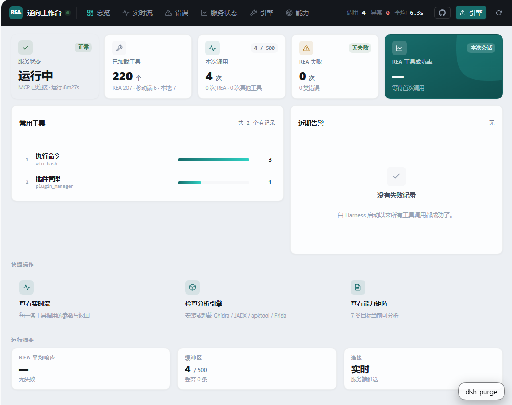

# dsh-rea-plugin

**REA 逆向工作台** —— 为 [DeepSeek Harness](https://github.com/deepseek-ai/deepseek-harness) 提供 220 个逆向工具、72 篇离线文档和 4 个 Agent 技能。

装完插件，Android 分析立刻可用；native 分析需点一次 Ghidra 安装。

界面全中文，不需要看英文就知道每个工具是做什么的。

[](https://github.com/jiuyou-7411/dsh-rea-plugin/releases)
[](https://github.com/jiuyou-7411/dsh-rea-plugin)
[](https://github.com/jiuyou-7411/dsh-rea-plugin)
[](LICENSE)
[](#安装)



---

## 界面

打开 DSH 左侧「REA」即可进入工作台：

| 区域 | 作用 |
|---|---|
| **顶部导航** | 总览 / 实时流 / 错误 / 服务状态 / 引擎 / 能力，右侧是 GitHub 与引擎管理按钮 |
| **KPI 卡片** | 服务状态、已加载工具、本次调用、失败次数、成功率 |
| **常用工具** | 按调用次数排序，中文名 + 原始工具 ID 双行显示 |
| **近期告警** | 失败调用会自动翻译成中文说明，并给出修复建议 |
| **快捷操作** | 查看实时流、检查分析引擎、查看能力矩阵 |

---

## 为什么做这个

逆向工具大多只有英文命令行，参数复杂、报错晦涩。这个插件把它们收进一个中文界面：

- **不懂英文也能用** —— 工具名、报错、状态全部中文化
- **报错能看懂** —— `file changed since it was read` 会翻译成「文件在你读过之后又被改动了」，并告诉你「重新读一次文件再改」
- **不用记命令** —— 220 个工具列在面板里，点开就能看参数
- **离线文档** —— 72 篇分析手册打包在插件里，断网也能查

---

## 能做什么 / 不能做什么

先看这一节，能省掉一场期待错位。

### 能做

| 目标 | 给你什么 | 需要什么 |
|---|---|---|
| **Android APK** | 解包、反编译 Java、smali、脱壳、Frida hook、SO 分析 | 装好即用 |
| **native 二进制**（PE / ELF / Mach-O） | 伪代码、汇编、调用图、字符串、交叉引用 | Ghidra |
| **.NET 程序集** | 类型、方法、字段、IL 调用边 | 装好即用 |
| **JavaScript / Electron** | 模块结构、路由、API 端点、IPC 通道 | 装好即用 |
| **WebAssembly** | 导入导出签名、WAT、段与候选函数 | 装好即用 |
| **固件镜像** | 签名扫描、提取、文件系统还原 | binwalk / unblob |
| **抓包文件**（pcap / HAR / SAZ） | 端点、DNS、TLS SNI、协议分布 | tshark |

### 不能做

**1. 不能还原原始源码**

给的是**反编译产物**——伪代码和汇编，不是原始代码。变量名是 `local_18`、`param_1` 这种，注释、类型、原来的函数名都没了。

想靠它「拿到完整源码」，拿不到。

**2. 不能自动破解**

遇到加壳、反调试、代码混淆，它**能分析能看**，但不会自动脱壳或帮你绕过。反注入检测、Janus 检查这些工具告诉你「有没有保护」，绕不绕得过要你自己动手。

**3. native 分析需要 Ghidra（1.5 GB）**

不装 Ghidra：

- ✅ Android 那套照常能用（JADX / apktool / Frida）
- ❌ 面对 exe、so、elf 只能看基础信息，出不来伪代码

面板上点「安装 Ghidra」即可，不用敲命令。

**4. 没有动态调试器**

Frida 是**运行时插桩**（挂到进程上读内存、改函数返回），不是 GDB 那种单步调试、设断点、看寄存器的调试器。

要看执行流：静态分析 + Frida 打点，没有单步。

**5. 不保证分析结果正确**

反编译器会猜错：间接调用解析不出来、虚函数的实际目标不确定、控制流可能断。插件里每个结论都标了来源（静态观察 / 运行时验证 / 推测），**没标的不要当事实用**。

**6. 不代替人判断**

工具给的是事实和候选，最后「这是不是漏洞」「这个算法是什么」得你自己定。

---

## 装了什么

| 类别 | 数量 | 来源 |
|---|---|---|
| **REA MCP 工具** | 207 | 上游 [rea-agents](https://github.com/morluto/rea)，自建桥接，无需配 profile |
| **移动端工具** | 6 | 内置 [MobileRE-Skill](https://github.com/index-login/MobileRE-Skill)：脱壳、Frida、反注入检测、SO 分析、模拟执行 |
| **本地工具** | 7 | 引擎安装、能力矩阵、脱壳、CLI 直调、文档检索 |
| **文档** | 72 篇 | 离线打包，1.2 MB |
| **Agent 技能** | 4 | 自动部署到 DSH 技能目录 |

---

## 安装

本插件通过 **GitHub 分发**，不走 npm（同名包 `dsh-plugin-rea` 已被他人发布，且国内访问 npm 不稳定）。

### 方式一：克隆仓库（推荐）

```bash
cd ~/.dsh/profiles/desktop

# 把插件克隆到本地
git clone https://github.com/jiuyou-7411/dsh-rea-plugin.git plugins/dsh-rea-plugin

# 声明为本地依赖
npm install ./plugins/dsh-rea-plugin
```

### 方式二：下载压缩包

从 [Releases](https://github.com/jiuyou-7411/dsh-rea-plugin/releases) 下载 `dsh-rea-plugin-x.x.x.tgz`，然后：

```bash
cd ~/.dsh/profiles/desktop
npm install /path/to/dsh-rea-plugin-3.0.0.tgz
```

### 启用

在 `cordis.yml` 加一行，然后重启 DSH：

```yaml
- id: rea-host
  name: 'dsh-rea-plugin'
  config:
    reaVersion: 6.7.0
    autoInstallProviders: true
```

详细步骤见 [INSTALL.md](INSTALL.md)。

### 更新

```bash
cd ~/.dsh/profiles/desktop/plugins/dsh-rea-plugin
git pull
npm install
```

然后重启 DSH。面板顶部的横幅会显示「代码落后上游 N 个提交」——这是 `git fetch` 后的真实差异，不是猜测。

---

## 它自己会做的事

装完插件、重启 DSH，以下全部自动完成，**不用点任何按钮**：

| 项目 | 耗时 | 失败处理 |
|---|---|---|
| 下载 `rea-agents`（207 个工具） | 5–30 秒 | 自动重试 5 次，退避共 52 秒 |
| 部署 4 个 Agent 技能 | <1 秒 | 写入 `.dsh/skills/rea/` 和 `.agents/skills/rea/` |
| 安装 apktool + jadx | 约 1 分钟 | 失败会显示原因和修复建议 |
| 安装 7 个 Python 包 | 约 2 分钟 | 自动测速选最快的镜像 |

**只有三样需要你主动点**：

| 项目 | 大小 | 为什么手动 |
|---|---|---|
| Ghidra | 543 MB | native 分析用，不是所有人都需要 |
| JDK 21 | 196 MB | 只有装 Ghidra 才需要 |
| Frida 引擎 | npm 全局 | 会写全局 npm，可能和已有冲突 |

---

## 界面

六个页面，顶部导航（不是左侧——插件本身就在 DSH 侧边栏里）：

| 页 | 能看什么 |
|---|---|
| **总览** | 工具总数、REA 成功率、常用工具、近期告警（中文解释） |
| **实时流** | 每次调用的参数和返回，点开看完整内容 |
| **错误** | 按错误类型聚合，中文说明「什么错 / 为什么 / 怎么办」 |
| **服务状态** | 六项检查，异常项给具体修复步骤 |
| **引擎** | 引擎、JDK、Python 依赖，每项独立安装/卸载 |
| **能力** | 8 类目标的分析能力、依赖哪个引擎 |

---

## 热更新

插件**不能替换自己正在运行的代码**——Node 还开着那些文件，Windows 上连改名都会失败。所以更新分两层：

### 前端：真热重载

改 `client.js` 后，DSH 的 HMR 会直接替换界面，**不用重启**。

### Host 端：必须重启

改 `lib/*.js`、`index.js` 后必须重启 DSH。这不是偷懒，是模块加载器的限制。

### 怎么知道有更新

面板顶部横幅读的是 `git fetch` 之后 `HEAD..@{u}` 的真实提交差：

```
● 代码落后上游 3 个提交
  在插件目录执行：
  git pull && npm install
  github.com/jiuyou-7411/dsh-rea-plugin
                                            [检查上游]
```

**不是猜的，不是查 npm。** 没有 `.git` 的安装副本（比如从 tgz 装的）只显示仓库地址，不显示提交数。

### 为什么不用 npm 检查版本

同名的 `dsh-plugin-rea` 在 npm 上是另一个作者（`czcdr`）的包，版本 2.0.10。如果面板按 npm 版本比较，会提示你"更新"到别人的代码。

所以 npm 检查是**默认关闭**的。需要时设环境变量 `REA_UPDATE_CHECK=1` 打开，且它仍然拒绝把低于当前版本的号当成"新版"。

---

## 需要什么

| 要求 | 检查 | 不满足会怎样 |
|---|---|---|
| Node.js 22.19+ / 24.11+ / 26+ | `node -v` | 插件不加载 |
| 网络（首次） | 能访问 npm | 自动重试 5 次后提示 |
| Python 3.9+（可选） | `python -V` | 6 个移动端工具不可用，其余正常 |

---

## 开发和发布

```bash
# 刷新上游内容（技能、文档索引、文档正文）
npm run sync:all

# 从上游内容重建 DSH 技能
npm run build:skills

# 打包前自检：文件完整性、数量、禁止路径、硬编码路径
npm run verify

# 打包
npm pack
```

`sync:all` 把上游内容 pin 到具体 commit，所以同一个插件版本永远对应同一份文档和技能。

---

## 和上游的关系

本插件是 [morluto/rea](https://github.com/morluto/rea) 的 DSH 集成层，不修改上游代码：

- 工具面与上游 MCP **完全一致**（207 个，无裁剪）
- 技能来自上游 `.agents/skills`，pin 到 commit `d672cc2`
- 文档来自上游 `docs/`，pin 到 commit `25bea07`
- MobileRE 是独立项目，补 Android 动态分析能力

---

## 许可

MIT。内置第三方内容各自遵循原项目许可，详见 [LICENSE](LICENSE)。
